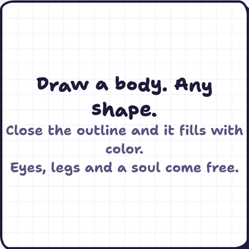
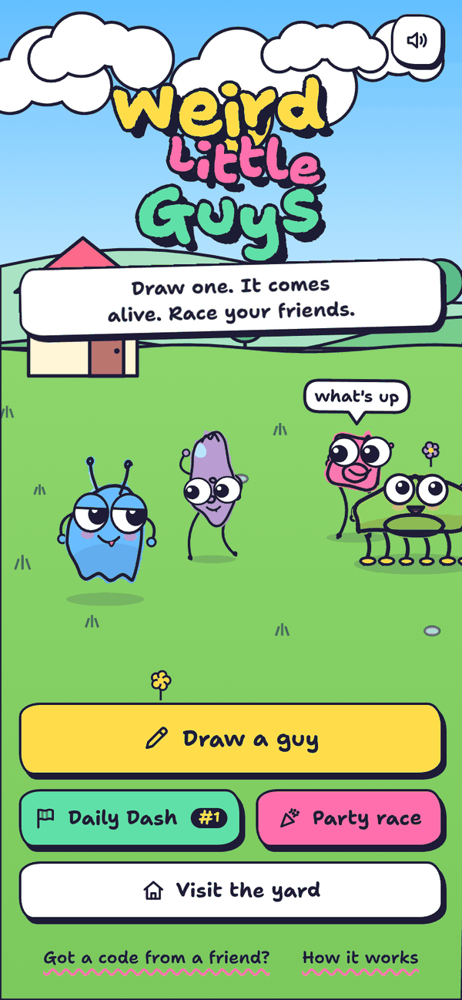
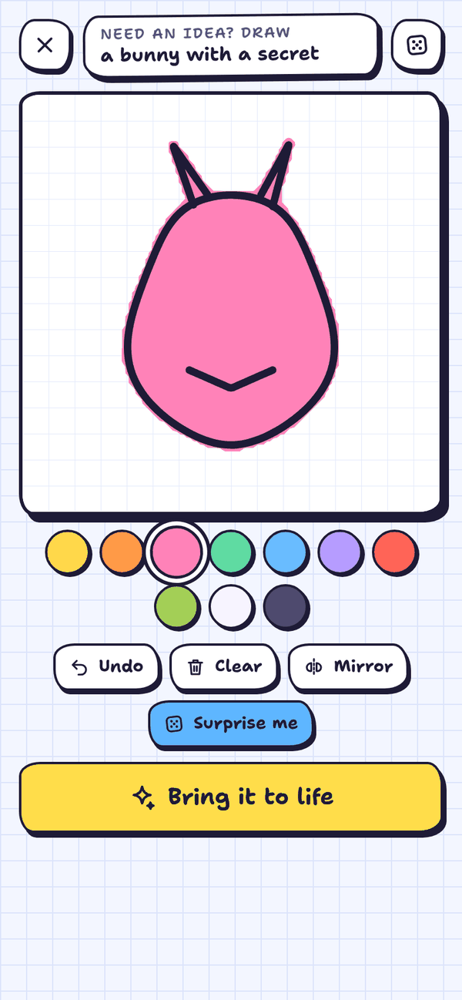
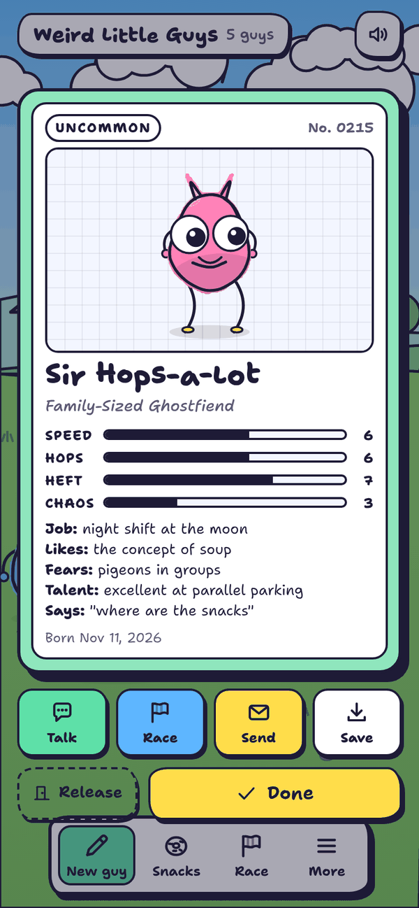
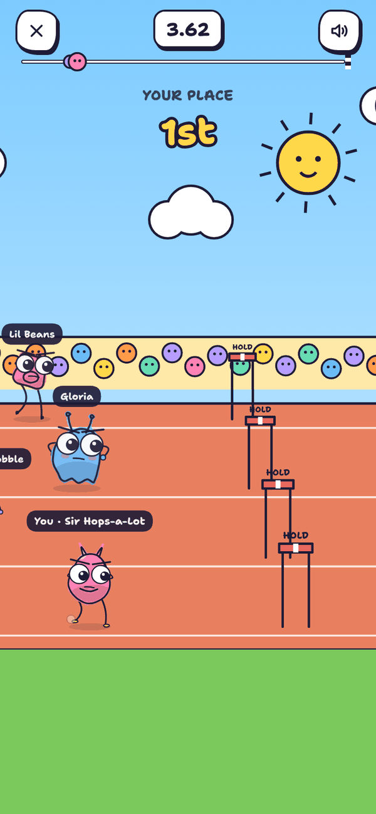
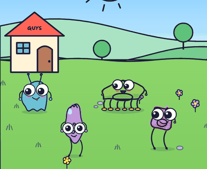
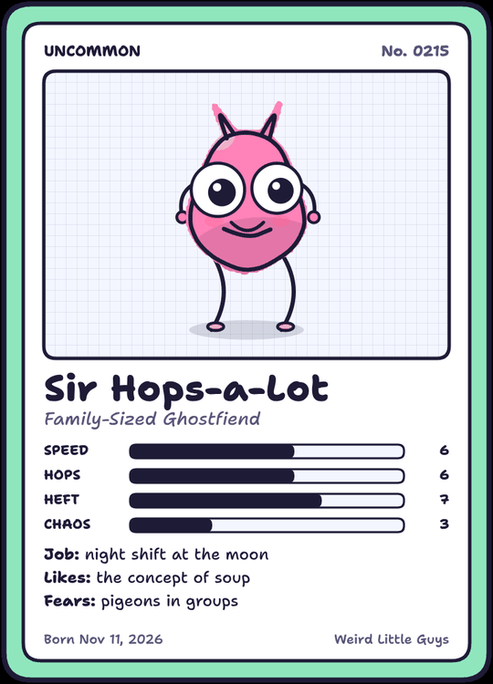
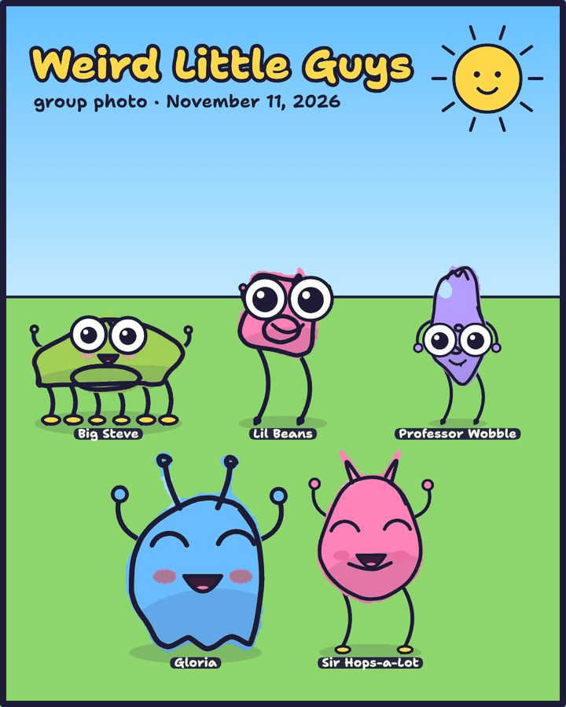
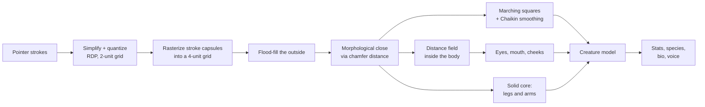

<div align="center">



# Weird Little Guys

**Draw one. It comes alive. Race your friends.**

A browser game where any doodle becomes a living creature.<br>
One HTML file, about 4,400 lines of vanilla JavaScript. No images, no audio files, no libraries.

[**Play it**](https://hanzalah5.github.io/weird-little-guys/) · [How it works](#how-it-works) · [Run it locally](#run-it-locally)

</div>

<br>

<table>
  <tr>
    <td align="center"><br><sub>Title</sub></td>
    <td align="center"><br><sub>Draw anything</sub></td>
    <td align="center"><br><sub>Every guy gets a card</sub></td>
    <td align="center"><br><sub>Daily Dash</sub></td>
  </tr>
</table>

## What it is

You draw a shape. The game traces it, fills it with color, works out where its eyes and mouth should go, and grows rubber-hose legs and noodle arms that walk with properly planted feet. The guy gets a name, a species ("Lesser Spotted Loafbeast"), four stats, a job, fears, a secret talent and a catchphrase, then moves into a little doodle yard with everyone else.

From there you can poke them, fling them across the yard, feed them snacks, throw a dance party, take a group photo, and race them in the **Daily Dash**, a new track every day that is the same for everyone who plays.

## Features

**Drawing**
- Close an outline and it fills with marker color. Small gaps are sealed automatically.
- **Mirror** draws both halves at once. **Surprise me** doodles a random guy.
- 40-odd prompts when you're stuck ("a pickle in its villain era", "a cactus who wants a hug").

**Coming alive**
- Googly eyes with real wobble, a mouth, blush, legs and arms, all placed to fit your shape. Skinny drawings get one eye or eyes on stalks.
- Pick 0–8 legs (0 makes it a hopper), arms or none, and shuffle the face while the guy stands in front of you.
- Each guy babbles in its own voice: big guys are low and slow, small ones squeaky.

**The yard**



- Guys wander, chat in speech bubbles, chase snacks and blink at your cursor.
- Drag and release to throw one. Throw it into another guy for a **BONK**.
- The yard follows your clock: sunsets, then a moon, stars, fireflies and sleeping guys ([see it at night](docs/screenshots/night.png)).
- Life stats are tracked per guy: snacks eaten, times thrown, races, wins.
- Dance party and a group photo you can save as an image.

<br clear="right">

**Racing**
- **Daily Dash**: a 60 m track seeded by the date. Tap to jump, hold to clear the red hurdles, avoid mud, hit boosts and mushroom springs.
- Three local rivals of rising skill, a translucent ghost of your personal best, and a crown for your guy if you win.
- **Challenge a friend**: your exact run is packed into a short code. They race your ghost on the same track.
- **Party race**: 2–4 players on one screen, each tapping their own lane.

**Sharing**
- Trading cards and group photos save as PNGs.
- Guys and race ghosts travel as short text codes or links (see [Sharing](#sharing-with-friends)).
- Wordle-style results for the group chat.

<p align="center">
  
  &nbsp;
  
</p>

## How to play

| Where | Do this | What happens |
| --- | --- | --- |
| Drawing pad | Draw with a finger or mouse | Closed outlines fill with color. `Ctrl/Cmd + Z` undoes. |
| Naming sheet | Tap legs, arms, Shuffle face | The guy updates live in front of you. |
| Yard | Tap a guy | Poke. Tap its name tag to open its card; long-press works too. |
| Yard | Drag and let go | Throw. Hard throws make guys dizzy. |
| Yard | Tap the grass | Drop a snack. The nearest guy runs over to eat it. |
| Race | Tap anywhere, or `Space` / `↑` | Jump. Hold for a higher jump over red hurdles. |
| Party race | Tap your lane, or `A` / `L` / `V` / `↑` | Jump for players 1–4. |

## Sharing with friends

Every guy packs into a short text code, usually 50–400 characters:

- `WLGg.…` is a guy. Paste it into **Got a code from a friend?** and that guy walks into your yard.
- `WLGr.…` is a race challenge: the guy plus a recording of every jump.
- When the game is served from a normal URL (like GitHub Pages), the share buttons produce links instead (`…/#g=…` and `…/#r=…`) that work with one tap.

After a Daily Dash you can copy a result like this:

```
Weird Little Guys · Daily Dash #1
🥇 Sir Hops-a-Lot — 18.84s
🟩⚡🟩🟩🟥🟩🟩🍄🟩🟩
```

## How it works

### From doodle to creature



- **Filling.** Strokes are stamped into an analysis grid as capsules at two radii: the ink itself, and a fattened version that bridges small gaps. The outside is flood-filled, then the region is eroded back with a 3-4 chamfer distance transform, which seals an almost-closed outline without bloating it.
- **Outline.** Marching squares traces each filled component; Chaikin subdivision smooths it and Ramer–Douglas–Peucker trims the points.
- **Face.** A distance transform of the body gives every point's clearance from the edge. A search over rows and eye spacings picks the largest pair of eyes that fits, biased upward and toward the middle. Narrow bodies fall back to one eye, then to eyes on stalks.
- **Limbs.** Legs attach along the bottom of the body's solid core (thin decorations like antennae are ignored); arms attach at its widest point.
- **Stats.** Size, aspect ratio, compactness, line detail and leg count feed SPEED, HOPS, HEFT and CHAOS, normalized to a fixed point budget so no shape is strictly better.

All of this is pure math on integer stroke data, with no canvas readback, so **the same drawing becomes the same guy, with the same stats and personality, on every device.**

### Animation

- **Gait.** Foot placement is driven by distance traveled: feet in stance stay fixed in the world while the body moves over them, then swing forward on an arc. Legs alternate in pairs (tripods for six).
- **Limbs.** Two-bone IK finds the knee; the leg is drawn as a quadratic curve through it, which gives the rubber-hose look.
- **Eyes.** Each pupil is a spring-damped particle that reacts to the body's acceleration and bounces off the eye's rim, so eyes wobble after a jump or a throw.
- **Line boil.** Every outline is pre-built as three `Path2D` frames with noise-jittered points and cycled at 8 fps, like hand-drawn animation.
- **Squash and stretch** on landings, hops and pokes, all from one spring.

### Deterministic racing and ghosts

The race runs on a fixed 60 Hz step with a seeded RNG per racer. A run is stored as a list of `(press frame, hold frames)` pairs, so a ghost replays to the exact millisecond on any device. A friend's challenge code is just their guy plus that list, varint-encoded. Racers who haven't crossed the line when the race ends are simulated to the finish with their own inputs, so times are always real.

### Sound

Everything you hear is synthesized with the Web Audio API at runtime:

- **Instruments:** marimba (sine plus an inharmonic partial), bell, whistle with delayed vibrato, bass, kick, snare, hi-hat.
- **Music:** four generative tracks (day, night, race, party) built from chord progressions, with seeded melodies that follow the chord tones.
- **Voices:** syllables are oscillators run through two band-pass "formant" filters per vowel, with noise bursts for consonants. Pitch comes from the guy's size.
- **Effects:** about 30 short sounds, from pops and boings to splashes and crowd cheers.

### Share codes

Strokes are quantized to a 2-unit grid, delta-encoded, zigzag-varint packed and base64'd. A typical guy fits in a few hundred characters.

## Run it locally

No install needed. Clone and open the page:

```bash
git clone https://github.com/hanzalah5/weird-little-guys.git
```

Then open `weird-little-guys/index.html` in any modern browser. Everything runs on your machine; your yard is saved in that browser's local storage.

### Editing the code

The game is split into modules under `src/` and bundled into `index.html` by a small Node script (Node 18+, no dependencies):

```bash
npm run build
```

This writes:

- `index.html`: the complete game, committed so GitHub Pages can serve it.
- `dist/weird-little-guys.html`: the same page without the outer `<html>`/`<head>`/`<body>`, for hosts that wrap pages in their own document.

`npm run dev` builds `dist/dev.html`, a visual test page that renders a grid of random guys with their stats.

### Putting it online

In the repository's **Settings → Pages**, choose **Deploy from a branch**, branch `main`, folder `/ (root)`. The game appears at `https://<user>.github.io/weird-little-guys/`, and the share buttons start producing links.

## Project structure

```
index.html            built game (generated by build.mjs)
build.mjs             bundler: src/js/*.js into src/template.html
src/
  template.html       markup and all CSS
  js/
    00-util.js        math, seeded RNG, noise, storage, icons
    01-content.js     names, species, bios, prompts, chatter
    02-guy.js         doodle analysis and the creature model
    03-codec.js       share codes
    04-render.js      creature renderer, speech bubbles, particles
    05-sound.js       synthesizer, sound effects, voices, music
    06-yard.js        persistence and the yard scene
    07-studio.js      drawing pad
    08-race.js        Daily Dash simulation and rendering
    09-ui.js          screens, cards, sharing, race menus, results, chat
    10-main.js        boot, game loop, input routing
dev/                  visual harness pages (npm run dev)
docs/                 images used in this README
```

## Notes

- Built for phones first: touch, safe areas and small screens are handled. Landscape and desktop work too.
- The handwritten font is [Shantell Sans](https://fonts.google.com/specimen/Shantell+Sans) (SIL Open Font License), loaded from Google Fonts. Offline, it falls back to a system font.
- **Talk** answers with an offline reply engine built from the guy's personality. If the page is embedded in a host that provides an AI text API, it can use that instead.
- Respects `prefers-reduced-motion` (no line boil or bouncing UI).

## License

[MIT](LICENSE)
